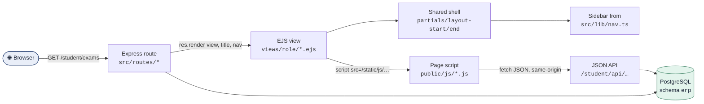
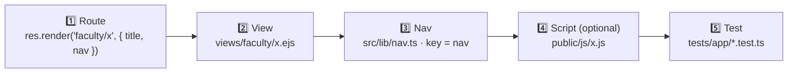
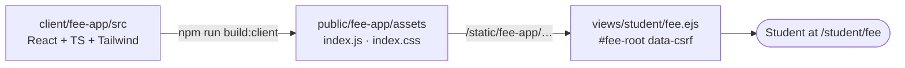

<div align="center">

# 🎨 PICT ERP · Frontend Guide

**How the portal's screens are built, styled and wired up, and how to add a page without breaking the others.**


[Architecture](#-architecture) ·
[Folder map](#-folder-map) ·
[Section-wise pages & tips](#-section-wise-pages--tips) ·
[Page anatomy](#-page-anatomy) ·
[Design system](#-design-system) ·
[Components](#-component-catalogue) ·
[Add a page](#-recipe-add-a-new-page) ·
[Browser JS](#-browser-javascript) ·
[Fee app](#-the-fee--d-wallet-react-app) ·
[Checklist](#-pre-merge-checklist)

</div>

---

## 🧭 At a glance

| | |
|---|---|
| **Rendering** | Pages are rendered on the server with **EJS**. No SPA framework drives the main portal. |
| **Styling** | One stylesheet, [`public/css/app.css`](../public/css/app.css), with CSS custom properties as design tokens. |
| **Interactivity** | Small, framework-free scripts in [`public/js/`](../public/js/). Every page must still render without JavaScript. |
| **Roles** | Three portals share one shell: **Student**, **Faculty** and **Academic Console** (admin). |
| **Exception** | The **Fee & D-Wallet** screen is a separate React + Vite + Tailwind app in [`client/fee-app`](../client/fee-app). |
| **Security** | A strict Content-Security-Policy: **no inline `<script>`** and **no inline `<style>` blocks**. |

> [!TIP]
> If you remember one rule from this guide: **a new page needs a route, a view _and_ a nav entry, and the nav `key` must equal the `nav` value the route renders with.**

---

## 🏗 Architecture



Pages come in two styles:

| Style | How it works | Examples |
|---|---|---|
| **Server-rendered** | The route queries the database and passes data into the template. | Dashboard, curriculum, offerings, admin lists, notices, grievances, placement |
| **Client-rendered** | The template is a shell with a placeholder. A page script fetches a JSON API and builds the DOM. | Student attendance / exams / hall ticket / results, faculty attendance and examination |

---

## 🗂 Folder map

```text
📦 dbmcie2
├── 📁 views
│   ├── 📁 partials        ← shared shell & components (layout, icons, pager, bars…)
│   ├── 📁 student         ← student portal pages
│   ├── 📁 faculty         ← faculty portal pages
│   ├── 📁 admin           ← academic console pages
│   ├── 📁 shared          ← pages reused across roles (notices, grievances)
│   ├── 📁 auth            ← login, change password
│   └── 📄 error.ejs
├── 📁 public               ← served at /static/*
│   ├── 📁 css
│   │   ├── 🎨 app.css                ← the design system
│   │   └── 🎨 faculty-dashboard.css  ← faculty dashboard only
│   ├── 📁 js
│   │   ├── ⚙️ app.js                 ← global enhancements (every page)
│   │   ├── ⚙️ student-records.js     ← student attendance / exams / results
│   │   ├── ⚙️ faculty-attendance.js
│   │   ├── ⚙️ faculty-examination.js
│   │   └── ⚙️ faculty-dashboard.js
│   └── 📁 fee-app          ← BUILD OUTPUT of client/fee-app (do not edit by hand)
├── 📁 client/fee-app       ← React source for Fee & D-Wallet
└── 📁 src
    ├── 📁 lib/nav.ts       ← sidebar links per role
    ├── 📁 lib/format.ts    ← `fmt` helpers available in every view
    └── 📁 routes           ← page routes and JSON APIs
```

> [!NOTE]
> `public/` is mounted at **`/static`**, so `public/js/app.js` is requested as `/static/js/app.js`.

---

## 🗺 Section-wise pages & tips

Every page in the portal, grouped by section, with the template that renders it, the script that drives it (if any), and tips for working on that section.

| Environment | Base URL |
|---|---|
| 💻 Local | `http://localhost:3100` (`npm run dev`) |
| 🌍 Live | `https://pict-erp-portal.vercel.app` |

Join a base URL and a path from the tables below. For example, `http://localhost:3100/student/exams`.

> [!NOTE]
> Sign-in IDs: student numbers (e.g. `STU202600004`), faculty codes (e.g. `FAC-CSE-074`) and `admin`. Demo passwords are in the gitignored `data/generated/demo-credentials.txt`. Never paste them into docs or commits.

**Legend:** 🖥 rendered on the server · ⚡ filled in by a script from a JSON API · ⚛️ React

<details open>
<summary><h3>🔐 Sign-in & account</h3></summary>

| Page | Path | Template | Type |
|---|---|---|---|
| Sign in | `/login` | `auth/login.ejs` | 🖥 |
| Change password | `/account/password` | `auth/change-password.ejs` | 🖥 |
| Home redirect | `/` | → the role's home (`/student`, `/faculty`, `/admin`) | — |

**Tips**
- 💡 These pages render **without** the sidebar: the shell hides it when there is no `user`.
- 💡 Accounts created with a generated password are sent to **Change password** on first sign-in. Remember this when a test login lands somewhere unexpected.
- 💡 The login form posts `login_id`, `password`, `_csrf` and `next`. Keep those field names if you restyle the form.

</details>

<details>
<summary><h3>🎓 Student portal: <code>/student</code></h3></summary>

| Group | Page | Path | Template | Script / API | Type |
|---|---|---|---|---|---|
| Overview | Dashboard | `/student` | `student/dashboard.ejs` | — | 🖥 |
| | Notices | `/student/notices` | `shared/notices.ejs` | — | 🖥 |
| | Placement | `/student/placement` | `student/placement-dashboard.ejs` | — | 🖥 |
| Academics | Curriculum | `/student/curriculum` | `student/curriculum.ejs` | — | 🖥 |
| | Course offerings | `/student/offerings` | `student/offerings.ejs` | — | 🖥 |
| | Electives | `/student/electives` | `student/electives.ejs` | — | 🖥 |
| Attendance | Summary | `/student/attendance` | `student/attendance-summary.ejs` | `student-records.js` → `/student/api/attendance` | ⚡ |
| | Detail | `/student/attendance/detail` | `student/attendance-detail.ejs` | `student-records.js` → `/student/api/attendance/:courseId` | ⚡ |
| Examination | Exam schedule | `/student/exams` | `student/exam-schedule.ejs` | `student-records.js` → `/student/api/exams` | ⚡ |
| | Hall ticket | `/student/hall-ticket` | `student/hall-ticket.ejs` | `student-records.js` → `/student/api/exams` | ⚡ |
| | Results | `/student/results` | `student/results.ejs` | `student-records.js` → `/student/api/results` | ⚡ |
| Finance | Fee & D-Wallet | `/student/fee` | `student/fee.ejs` | `public/fee-app` (React) | ⚛️ |
| Placement | Profile | `/student/placement/profile` | `student/placement-profile.ejs` | — | 🖥 |
| | Drives | `/student/placement/drives` | `student/placement-drives.ejs` | — | 🖥 |
| | Drive detail | `/student/placement/drives/:id` | `student/placement-drive.ejs` | — | 🖥 |
| | My applications | `/student/placement/applications` | `student/placement-applications.ejs` | — | 🖥 |
| Records | Profile | `/student/profile` | `student/profile.ejs` | — | 🖥 |
| | Grievances | `/student/grievances` · `/new` · `/:id` | `shared/grievances*.ejs`, `shared/grievance-detail.ejs` | — | 🖥 |

**Tips**
- 💡 **One script, five pages.** `student-records.js` picks what to render from the `data-student-view` attribute (`attendance-summary`, `attendance-detail`, `exam-schedule`, `hall-ticket`, `results`). To add a view, add a new value and a matching branch. Don't create a second script.
- 💡 **If those five pages show an error instead of data**, open DevTools → Network and check the `/student/api/...` call first. A 404 there means the API router isn't mounted (`studentRouter.use('/api', studentApiRouter)` in `student-routes.ts`).
- 💡 **Empty exam or result tables are usually missing data, not a frontend bug.** The APIs return `[]` when no exam cycle or marks exist. Design a friendly `.empty` message for that case.
- 💡 **Eligibility:** ≥ 75% attendance **and** status `Registered`. Show it with `.pill.g` / `.pill.r` plus a text label, never colour alone.
- 💡 **Hall tickets get printed.** Check the print preview: the `@media print` rule hides the sidebar, top bar and `.actions`.
- 💡 **Attendance colours:** use the `pct-bar` partial (red below 75, orange within 5 points) instead of hand-coloured numbers, so every page uses the same thresholds.

</details>

<details>
<summary><h3>👩‍🏫 Faculty portal: <code>/faculty</code></h3></summary>

| Group | Page | Path | Template | Script / API | Type |
|---|---|---|---|---|---|
| Overview | Dashboard | `/faculty` | `faculty/dashboard.ejs` | `faculty-dashboard.js` + `faculty-dashboard.css` → `/api/faculty/:id/*` | ⚡ |
| | Notices | `/faculty/notices` | `shared/notices.ejs` | — | 🖥 |
| Attendance | Attendance | `/faculty/attendance` | `faculty/attendance.ejs` | `faculty-attendance.js` → `/faculty/attendance/assignments/…` | ⚡ |
| Examination | Marks entry | `/faculty/examination` | `faculty/examination.ejs` | `faculty-examination.js` → `/faculty/examination/courses/…` | ⚡ |
| Teaching | My classes | `/faculty/classes` | `faculty/classes.ejs` | — | 🖥 |
| | Class roster | `/faculty/classes/:id` | `faculty/class-roster.ejs` | — | 🖥 |
| | Syllabus coverage | `/faculty/classes/:id/syllabus` | `faculty/syllabus-coverage.ejs` | — | 🖥 |
| | Student | `/faculty/students/:id` | `faculty/student.ejs` | — | 🖥 |
| | Placement report | `/faculty/placement` | `faculty/placement-report.ejs` | — (**HOD only**) | 🖥 |
| Records | Profile | `/faculty/profile` | `faculty/profile.ejs` | — | 🖥 |
| | Grievances | `/faculty/grievances` · `/new` · `/:id` | `shared/grievances*.ejs` | — | 🖥 |

**Tips**
- ⚠️ **Known issue: the dashboard has 29 inline handlers** (`onclick="navigateTo(…)"` and similar) in `faculty/dashboard.ejs`. The site's security policy blocks inline handlers (`script-src-attr 'none'`), so those buttons and links do nothing. Replace them with `data-*` attributes and attach listeners in `faculty-dashboard.js`.
- 💡 **Faculty dashboard styles are separate.** `faculty-dashboard.css` is loaded only on `/faculty`. Use `app.css` tokens (`var(--navy)` …) there too, so the dashboard matches the rest of the portal.
- 💡 **Marks entry shows only the components that apply:** TH = internal 20 + midsem 20 + endsem 60; LAB = internal 50 + practical 50 (no midsem). The fields come from `course_exam_scheme`, so don't hard-code maxima in the UI.
- 💡 **Keep inline validation accessible:** set `aria-invalid` on the input and put the message in the `.field-error` span next to it, as `faculty-examination.js` does.
- 💡 **Attendance edits lock after 14 days.** Older sessions need an admin-approved unlock (valid for 48 hours). Show the lock or request state from the sessions API; don't recalculate dates in the browser.
- 💡 **Placement report returns 403** for anyone who isn't a head of department. That's by design. If you show the link to every faculty member, explain what it's for.

</details>

<details>
<summary><h3>🛡 Academic Console (admin): <code>/admin</code></h3></summary>

| Group | Page | Path | Template | Type |
|---|---|---|---|---|
| Overview | Dashboard | `/admin` | `admin/dashboard.ejs` | 🖥 |
| | Inbox | `/admin/inbox` | `shared/notices.ejs` | 🖥 |
| Academics | Departments | `/admin/departments` · `/:id` | `admin/departments.ejs`, `admin/department-edit.ejs` | 🖥 |
| | Programs | `/admin/programs` · `/:id` | `admin/programs.ejs`, `admin/program-detail.ejs` | 🖥 |
| | Courses | `/admin/courses` · `/new` · `/:id` | `admin/courses.ejs`, `admin/course-form.ejs`, `admin/course-detail.ejs` | 🖥 |
| | Sessions | `/admin/sessions` | `admin/sessions.ejs` | 🖥 |
| | Sections | `/admin/sections` · `/divisions/:id` | `admin/sections.ejs`, `admin/division-detail.ejs` | 🖥 |
| | Electives | `/admin/electives` · `/:id` | `admin/electives.ejs`, `admin/elective-detail.ejs` | 🖥 |
| People | Students | `/admin/students` · `/:id` | `admin/students.ejs`, `admin/student-detail.ejs` | 🖥 |
| | Faculty | `/admin/faculty` · `/:id` | `admin/faculty.ejs`, `admin/faculty-detail.ejs` | 🖥 |
| Attendance | Unlock requests | `/admin/attendance-unlocks` | `admin/attendance-unlocks.ejs` | 🖥 |
| Communication | Notices | `/admin/notices` · `/new` · `/:id` | `admin/notices.ejs`, `admin/notice-new.ejs`, `admin/notice-detail.ejs` | 🖥 |
| | Grievances | `/admin/grievances` · `/:id` | `admin/grievances.ejs`, `admin/grievance-detail.ejs` | 🖥 |
| Placement | Dashboard | `/admin/placement` | `admin/placement-dashboard.ejs` | 🖥 |
| | Companies | `/admin/placement/companies` · `/:id` | `admin/placement-companies.ejs`, `admin/placement-company-edit.ejs` | 🖥 |
| | Drives | `/admin/placement/drives/new` · `/:id` | `admin/placement-drive-form.ejs`, `admin/placement-drive-detail.ejs` | 🖥 |
| | Applicants CSV | `/admin/placement/drives/:id/applicants.csv` | — (file download) | — |
| | Statistics | `/admin/placement/statistics` | `admin/placement-statistics.ejs` | 🖥 |
| System | Audit log | `/admin/audit` | `admin/audit.ejs` | 🖥 |

**Tips**
- 💡 **The admin console is all server-rendered.** Keep it that way: list → filter → detail pages with plain forms and redirects work well and need no JavaScript.
- 💡 **Large lists need paging.** There are 50,000 students, so use the `pager` partial and `.filters` (with `<select data-autosubmit>`). Never render a full table.
- 💡 **The top-bar search** (admin only) submits `q` to `/admin/students`. Keep that page's `q` filter working when you change it.
- 💡 **Put `data-confirm` on destructive buttons** (disable account, remove course, reject request) and give them `.btn.danger` / `.btn.small danger`.
- 💡 **Shared partials:** `admin/account-card.ejs` and `admin/course-fields.ejs` are reused across pages. Change them once and check every page that includes them.

</details>

<details>
<summary><h3>📣 Shared modules: notices, notifications & grievances</h3></summary>

| Module | Paths | Templates |
|---|---|---|
| Notices | `/<role>/notices` · `/new` · `/:id` (admin: `/admin/inbox`, `/admin/notices`) | `shared/notices.ejs`, `shared/notice-new.ejs`, `shared/notice-detail.ejs`, `partials/notices-card.ejs`, `partials/notice-fields.ejs` |
| Notification bell | `/api/notifications/state` (polled by `app.js`) | top bar in `partials/layout-start.ejs` |
| Grievances | `/student/grievances`, `/faculty/grievances`, `/admin/grievances` | `shared/grievances.ejs`, `shared/grievance-new.ejs`, `shared/grievance-detail.ejs`, `partials/grievance-thread.ejs` |

**Tips**
- 💡 **One template, three roles.** The same `shared/*.ejs` files serve every role, with the routes passing role-specific data and links into them. Test any change as student, faculty **and** admin.
- 💡 **Notification badge:** `app.js` polls the state endpoint and reloads an open notice board (`[data-notification-board]`) when its revision changes. Keep that attribute if you rebuild the board.
- 💡 **Grievance threads** come from `partials/grievance-thread.ejs`, so style the thread once there.

</details>

---

## 🧱 Page anatomy

Every portal page follows the same skeleton:

```ejs
<%- include('../partials/layout-start') %>

<div class="page-head">
  <h1>Exam Schedule</h1>
  <span class="sub">Your registered exam dates, sessions and attendance eligibility.</span>
</div>

<section class="card">
  … page content …
</section>

<%- include('../partials/layout-end') %>
```

<details>
<summary><b>🔍 What the shell gives you for free</b></summary>

<br/>

| Region | Source | Notes |
|---|---|---|
| `<head>`, font, favicon, `app.css` | `partials/head.ejs` | Title comes from `title` and renders as `Title · PICT ERP`. |
| Sidebar | `partials/layout-start.ejs` + `src/lib/nav.ts` | Highlights the item whose `key === nav`. |
| Top bar | `partials/layout-start.ejs` | Mobile menu button, admin student search, current term, notification bell, account menu. |
| Flash message | `partials/layout-start.ejs` | Shows `flash.type` (`success`, `error` or `info`) above the content. |
| Footer + `app.js` | `partials/layout-end.ejs` | Loads the global script with `defer`. |

</details>

### Values every view can use

| Local | Type | Purpose |
|---|---|---|
| `title` | `string` | Page title (pass it from the route). |
| `nav` | `string` | Sidebar key to highlight (pass it from the route). |
| `user` | object | Signed-in user: `role`, `displayName`, `loginId`, … |
| `csrfToken` | `string` | Put it in every form as `<input type="hidden" name="_csrf">`. |
| `currentSession` | object | Current academic term (shown in the top bar). |
| `flash` | object | One-time message set with `flash(req, type, text)`. |
| `fmt` | helpers | `fmt.date`, `fmt.shortDate`, `fmt.dateTime`, `fmt.pct`, `fmt.num`, `fmt.time`, `fmt.credits`, `fmt.roman`, `fmt.initials`, … |
| `NAV`, `appName` | app-wide | Used by the shell; you rarely need them directly. |

---

## 🎨 Design system

The visual language comes from the group mockups in [`docs/mockups/`](mockups/). It is calm and data-dense: a navy brand colour, white cards on a soft grey canvas, and colour reserved for **status**.

### Colour tokens

Defined on `:root` in `app.css`. **Always use the variable, never the hex value.**

#### Brand & text

| Swatch | Token | Value | Use for |
|:---:|---|---|---|
|  | `--navy` | `#1F3A6E` | Brand, primary buttons, active nav |
|  | `--hero` | `#16284D` | Dark hero banners |
|  | `--link` | `#1F4FA3` | Links |
|  | `--text` | `#172033` | Body text |
|  | `--text-2` | `#3B4458` | Secondary text, labels |
|  | `--muted` | `#5B6578` | Hints, sub-headings |
|  | `--faint` | `#7A8497` | Table headers, group labels |

#### Status (each colour has a matching `-bg` tint)

| Swatch | Token | Meaning | Pill class |
|:---:|---|---|---|
|  | `--green` / `--green-bg` | Success, eligible, paid | `.pill.g` |
|  | `--org` / `--org-bg` | Warning, pending, near threshold | `.pill.o` |
|  | `--red` / `--red-bg` | Error, below threshold, rejected | `.pill.r` |
|  | `--violet` / `--violet-bg` | Category accent | `.pill.v` |
|  | `--teal` / `--teal-bg` | Category accent | `.pill.t` |

#### Surfaces

| Swatch | Token | Value | Use for |
|:---:|---|---|---|
|  | `--bg` | `#F3F5F8` | Page canvas |
|  | `--surface` | `#FFFFFF` | Cards, sidebar, top bar |
|  | `--surface-2` | `#F8F9FB` | Inputs, hover states |
|  | `--line` | `#DDE2EA` | Borders |
|  | `--line-2` | `#EEF0F5` | Subtle row dividers |

### Typography & spacing

| Element | Size | Weight | Notes |
|---|---|---|---|
| Body | 14px | 400 | `line-height: 1.45`, **tabular numbers** everywhere |
| `h1` | 22px | 600 | One per page, inside `.page-head` |
| `h2` | 15px | 600 | Card headings |
| `.kpi` | 30px | 600 | Big numbers on dashboard cards |
| Table header | 11.5px | 600 | Uppercase, letter-spaced, `--faint` |

`--radius: 10px` for cards · `8px` for buttons/inputs · `4px` for pills · sidebar width `--side-w: 232px`.

> [!IMPORTANT]
> Colour carries meaning here. Use green, orange and red **only** for status, and always pair the colour with text (a pill label, a percentage). Colour must never be the only signal.

---

## 🧩 Component catalogue

<details open>
<summary><b>Cards & layout grids</b></summary>

```html
<div class="cards">                        <!-- responsive auto-fit grid, min 260px -->
  <section class="card">
    <h2>Attendance</h2>
    <div class="kpi">82<small>%</small></div>
  </section>
</div>

<div class="grid2">…main…  …aside…</div>   <!-- 2:1 split, stacks below 1080px -->

<section class="card t">                   <!-- "t" = flush table card -->
  <div class="hd"><h2>Courses</h2></div>
  <div class="sc"><table>…</table></div>   <!-- .sc = horizontal scroll on small screens -->
</section>
```
</details>

<details>
<summary><b>Buttons</b></summary>

```html
<a class="btn" href="…">Secondary</a>
<button class="btn primary" type="submit">Save</button>
<button class="btn danger" type="submit">Delete</button>
<a class="btn small" href="…">Next →</a>
```
</details>

<details>
<summary><b>Status pills & tags</b></summary>

```html
<span class="pill">Default</span>
<span class="pill g">Eligible</span>
<span class="pill o">Pending</span>
<span class="pill r">Below 75%</span>
<span class="pill n">Neutral</span>

<!-- inside a dark .hero banner -->
<span class="tag ok">Registered</span>  <span class="tag warn">Action needed</span>
```
</details>

<details>
<summary><b>Forms</b></summary>

```ejs
<form method="post" action="/student/profile" data-confirm="Save these changes?">
  <input type="hidden" name="_csrf" value="<%= csrfToken %>">
  <div class="form-grid">
    <div class="field">
      <label for="phone">Phone</label>
      <input id="phone" name="phone" value="<%= profile.phone %>">
      <span class="hint">10-digit mobile number</span>
    </div>
  </div>
  <button class="btn primary" type="submit">Save</button>
</form>
```

- `data-confirm="…"` asks before submitting. Use it for destructive actions.
- `<select data-autosubmit>` submits its form on change. Use it for filter bars (`.filters`).
</details>

<details>
<summary><b>Flash, empty and loading states</b></summary>

```html
<div class="flash success">Profile updated.</div>
<div class="flash error">Could not save marks.</div>
<div class="flash info">Applications close on Friday.</div>

<div class="empty">No courses were found for this term.</div>
<div class="student-state">Loading your exam schedule…</div>
```

Flash messages from a route: `flash(req, 'success', 'Saved.')`, then redirect.
</details>

<details>
<summary><b>Partials: percentage bar, pager, icons</b></summary>

```ejs
<%- include('../partials/pct-bar', { value: 72.5, min: 75, digits: 1 }) %>
<!-- turns orange within 5 points of `min` and red below it -->

<%- include('../partials/pager', { pager, qs }) %>

<%- include('../partials/icon', { name: 'calendar', size: 18 }) %>
```

**Available icons:** `home` `list` `user` `users` `building` `book` `calendar` `briefcase` `shield` `search` `menu` `clock` `alert` `bell` `check` `wallet`.
To add one, put its SVG path in `partials/icon.ejs` (24×24 viewBox, stroke icons).
</details>

<details>
<summary><b>Hero banner (dashboards)</b></summary>

```html
<section class="hero">
  <h1 class="name">Good morning, Aishani</h1>
  <div class="sub">SE Computer · Division A</div>
  <div class="progress"><i style="width: 46%"></i></div>
</section>
```

Inline `style="width:…"` attributes are allowed; the CSP permits style *attributes* but not `<style>` blocks.
</details>

---

## 🛠 Recipe: add a new page



**1 · Route** in the role's router (`src/routes/<role>-routes.ts`, or a sub-router mounted from it):

```ts
facultyRouter.get('/timetable', async (req, res) => {
  const rows = await getFacultyTimetable(req.user!.facultyId!);
  res.render('faculty/timetable', { title: 'Timetable', nav: 'timetable', rows });
});
```

**2 · View** at `views/faculty/timetable.ejs`, using the [page anatomy](#-page-anatomy) above.

**3 · Nav entry** in `src/lib/nav.ts`:

```ts
{ label: 'TEACHING', items: [
  { key: 'classes',   label: 'My classes', href: '/faculty/classes',   icon: 'users' },
  { key: 'timetable', label: 'Timetable',  href: '/faculty/timetable', icon: 'calendar' },
] },
```

**4 · Script (only if the page is client-rendered)**: see [Browser JavaScript](#-browser-javascript).

**5 · Test**: add a page test under `tests/app/` that signs in and expects `200`.

> [!WARNING]
> **Mounting order and merges.** Role routers are mounted in `src/app.ts`, `src/routes/student-routes.ts`, `src/routes/faculty-routes.ts` and `src/routes/admin/index.ts`. These files are where most merge conflicts happen. If two branches add a router or nav entry on the same line, **keep both lines**. Picking one side has already caused 404s on the exam, attendance-unlock and student API pages.

---

## ⚙️ Browser JavaScript

### Ground rules

1. **No inline scripts.** CSP is `script-src 'self'`, so put code in `public/js/*.js` and load it with `<script src="/static/js/x.js" defer></script>`.
2. **Progressive enhancement.** Server-rendered pages must work with JavaScript turned off. `app.js` only enhances them.
3. **No frameworks or build step** for the main portal. Write plain ES5-style code wrapped in an IIFE, the same as the existing scripts.
4. **Build DOM with `textContent`**, never `innerHTML` with data, so API values can't inject markup.

### What `app.js` already does on every page

| Feature | Hook |
|---|---|
| Mobile sidebar toggle (+ `Esc` / outside click to close) | `[data-menu]` |
| Confirm before submit | `<form data-confirm="…">` |
| Auto-submit filters | `<select data-autosubmit>` |
| Close the account menu on outside click | `details.me-menu` |
| Live notification badge (polls, pauses when the tab is hidden) | `[data-notification-unread]` |

### Client-rendered page pattern

```ejs
<!-- views/student/exam-schedule.ejs -->
<section class="card" data-student-view="exam-schedule" aria-live="polite">
  <div class="student-state">Loading your exam schedule…</div>
</section>
<script src="/static/js/student-records.js" defer></script>
```

```js
// public/js/<page>.js
(function () {
  'use strict';
  var root = document.querySelector('[data-student-view]');
  if (!root) return;                                    // script is harmless on other pages

  function fetchJson(url, options) {
    var config = Object.assign({ credentials: 'same-origin', headers: { Accept: 'application/json' } }, options || {});
    return fetch(url, config).then(function (response) {
      if (response.redirected) throw new Error('Your session has expired. Sign in again to continue.');
      return response.json().then(function (data) {
        if (!response.ok) throw new Error(data.error || 'The request could not be completed.');
        return data;
      });
    });
  }

  fetchJson('/student/api/exams')
    .then(render)
    .catch(function (error) {
      var box = document.createElement('div');
      box.className = 'flash error';
      box.textContent = error.message;
      root.replaceChildren(box);
    });
}());
```

### Writes from the browser (CSRF)

Every unsafe request (`POST`, `PUT`, `DELETE`, …) must carry the session's CSRF token, either as a `_csrf` body field or as an `X-CSRF-Token` header. Render the token into the page and read it from there:

```ejs
<input type="hidden" name="_csrf" value="<%= csrfToken %>">
```

```js
var csrfToken = document.querySelector('input[name="_csrf"]').value;
fetchJson('/faculty/examination/courses/' + id + '/marks', {
  method: 'POST',
  headers: { Accept: 'application/json', 'Content-Type': 'application/x-www-form-urlencoded', 'X-CSRF-Token': csrfToken },
  body: new URLSearchParams({ _csrf: csrfToken, entries_json: JSON.stringify(entries) }).toString(),
});
```

### Existing page scripts

| Script | Pages | API it calls |
|---|---|---|
| `student-records.js` | `/student/attendance`, `/attendance/detail`, `/exams`, `/hall-ticket`, `/results` | `/student/api/*` |
| `faculty-attendance.js` | `/faculty/attendance` | `/faculty/attendance/assignments/…` |
| `faculty-examination.js` | `/faculty/examination` | `/faculty/examination/courses/…` |
| `faculty-dashboard.js` | `/faculty` (with `faculty-dashboard.css`) | `/api/faculty/:facultyId/*` |

---

## 💳 The Fee & D-Wallet React app

The fee screen is the one place where React is used. It's built separately and mounted inside a normal EJS page.



| Task | Command |
|---|---|
| Install + production build | `npm run build:client` |
| Rebuild on change | `npm run dev:client` |
| Type-check + build inside the app | `npm --prefix client/fee-app run build` |

| Env var (Vite) | Default | Effect |
|---|---|---|
| `VITE_API_BASE_URL` | `/api` | Base URL for fee API calls |
| `VITE_USE_SAMPLE_DATA` | unset | `true` shows sample data so the UI works without a backend |

> [!CAUTION]
> **The fee backend is not implemented yet.** The app calls `/api/student/me`, `/api/fees/statement`, `/api/fees/payments` and `/api/wallet`, but no Express routes serve these yet. The database tables exist (migration `091-fee-and-wallet.sql`). Until the routes exist, the page only works in sample mode.

- **Never hand-edit `public/fee-app/`.** It is build output and gets overwritten.
- Tailwind is scoped to the fee app. Don't use Tailwind classes in EJS views; use the `app.css` components.

---

## 📱 Responsive & ♿ accessible by default

| Breakpoint | What changes |
|---|---|
| **≤ 1080px** | `.grid2` stacks into one column |
| **≤ 900px** | Sidebar becomes an off-canvas drawer opened by the menu button; tighter padding; search moves to its own row |
| **≤ 560px** | Smaller KPI and heading sizes; term badge hidden; filter inputs go full-width |
| **Print** | Sidebar, top bar, footer and `.actions` are hidden, so hall tickets and receipts print cleanly |

**Accessibility essentials already used across the portal (please keep them):**

- ✅ One `h1` per page; real `<label for>` on every input.
- ✅ `aria-current="page"` on the active nav link (the shell handles it).
- ✅ `aria-live="polite"` on containers that a script fills in.
- ✅ `.sr-only` text for icon-only buttons (see the menu button and bell).
- ✅ `aria-invalid` plus a visible message for field errors (see `faculty-examination.js`).
- ✅ Visible focus outlines. Don't remove them.

---

## ✅ Pre-merge checklist

- [ ] Route renders with **`title`** and a **`nav`** key that matches `src/lib/nav.ts`
- [ ] View starts with `layout-start` and ends with `layout-end`
- [ ] Only design tokens (`var(--…)`) and existing classes; any new CSS goes in `app.css`
- [ ] No inline `<script>` or `<style>` blocks
- [ ] Every form and unsafe `fetch` sends the CSRF token
- [ ] Loading, empty and error states are handled
- [ ] Works at phone width (≤ 560px) with no horizontal page scroll
- [ ] No sidebar link goes to a 404, and merge conflicts kept **both** sides' routers and nav items
- [ ] `npm run typecheck`, `npm run build` and the relevant `npm test -- tests/app/…` pass

---

## 🩺 Troubleshooting

| Symptom | Likely cause | Fix |
|---|---|---|
| Page shows **Not found** but the template exists | Router not mounted (often lost in a merge) | Check the mounts in `app.ts`, `<role>-routes.ts` and `admin/index.ts` |
| Page loads but says **"request could not be completed"** | The JSON API it fetches returns 404/500 | Open DevTools → Network; check the API route and that its migrations are applied |
| **Something went wrong** on a new module | Its migrations are not applied to that database | `npm run db:migrate` (local) or `npm run supabase:migrate` (production) |
| Sidebar link missing or not highlighted | `nav.ts` entry missing, or `key` ≠ `nav` | Align the key with the value passed to `res.render` |
| Script does nothing; console shows a CSP error | Inline script or an external script host | Move the code to `public/js/` and load it with `src` |
| `403` on form submit | Missing or stale CSRF token | Include `_csrf` / `X-CSRF-Token`; reload the page |
| Fee page is blank | `public/fee-app` not built | `npm run build:client` |

---

<div align="center">

**Related docs:** [Setup](../SETUP.md) · [Deployment](deployment.md) · [Work assignments](work-assignments.md) · [Mockups](mockups/)

<sub>Keep this guide current: if you add a component, token or page pattern, document it here in the same PR.</sub>

</div>
